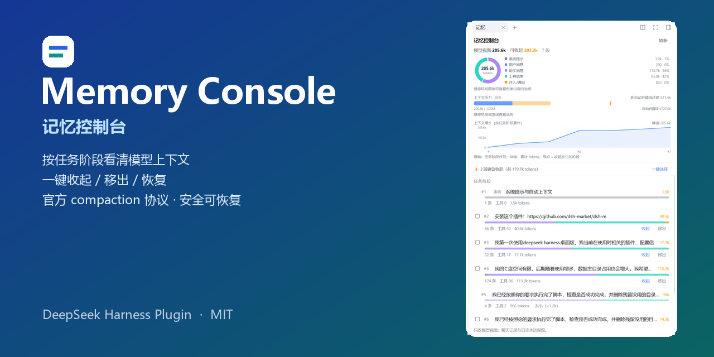
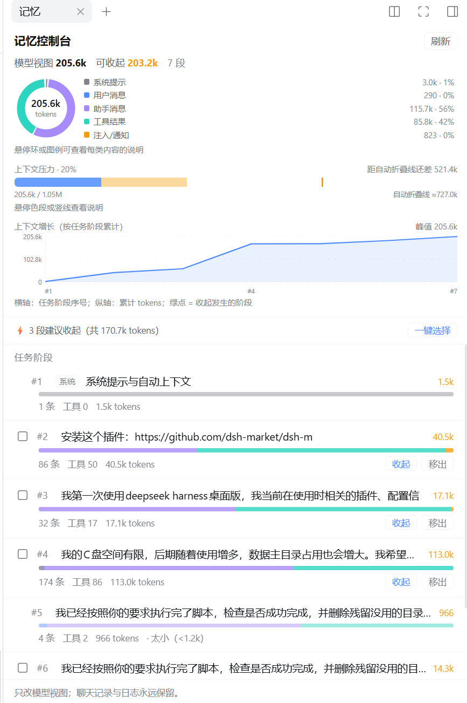
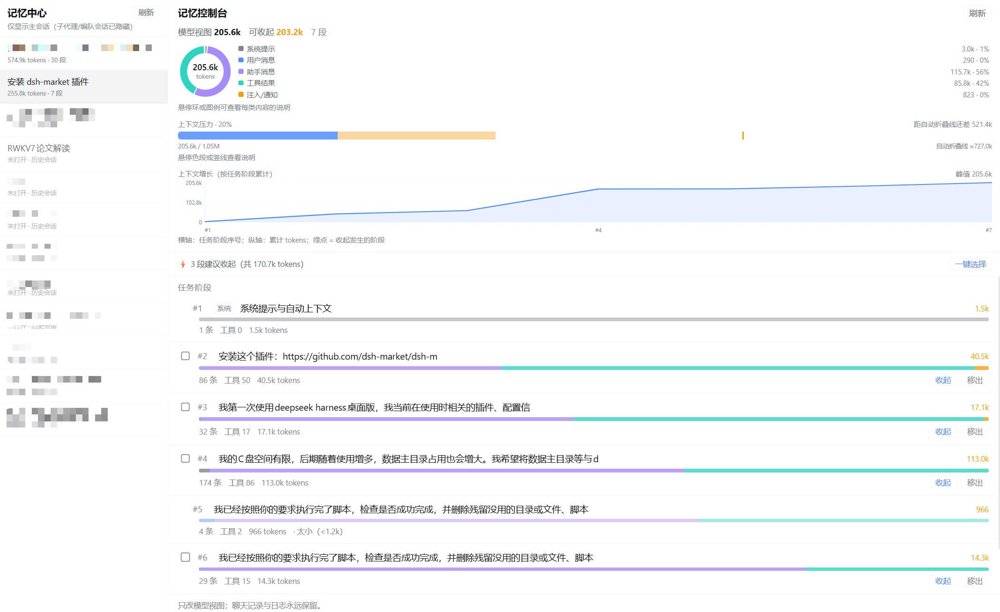
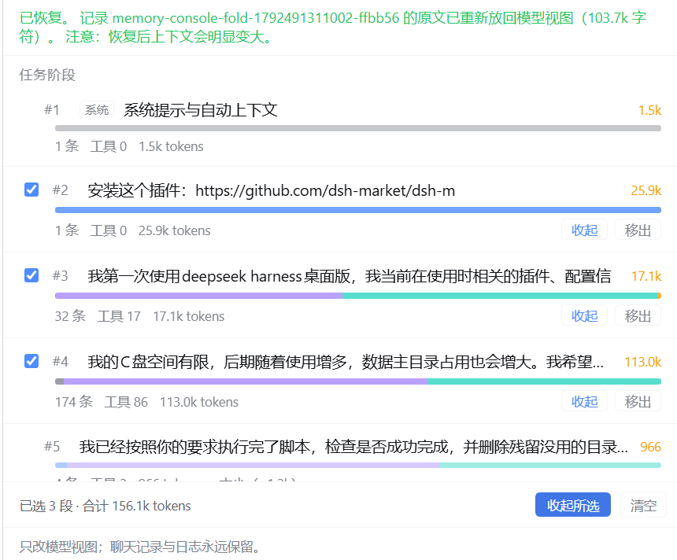
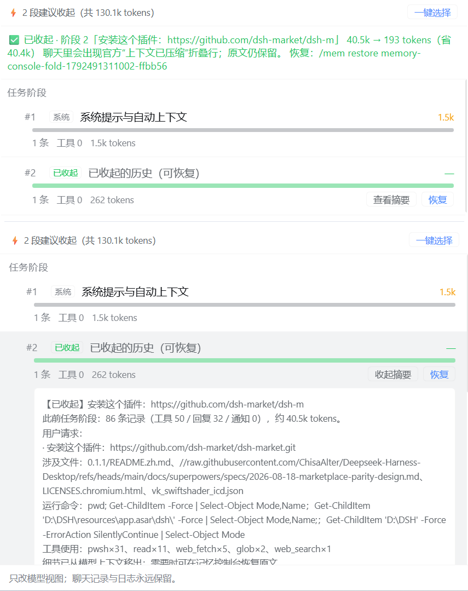

# Memory Console · 记忆控制台

<p align="center">
  
</p>

<p align="center">
  <b>给 DeepSeek Harness 的上下文记忆控制台：按任务阶段看清模型装了什么，并主动收起、移出、恢复。</b><br/>
  只改模型视图，聊天记录与会话日志永远保留。
</p>

<p align="center">
  <a href="LICENSE"></a>
  
</p>

---

## 为什么做这个

长会话里，模型上下文是一个黑盒：

- 到底哪一段在吃 token？是工具输出，还是早期闲聊？
- 现在该继续聊，还是该收起早期内容？
- 收起之后模型还"记得"什么？还能恢复吗？
- 一次收几段、收哪几段，会不会把关键约束收掉？

大多数"记忆插件"解决的是"**存更多**"；Memory Console 解决的是"**管得住**"：
把上下文切成可理解的**任务阶段**，让"收起 / 移出 / 恢复"变成一次可预览、可撤销、可审计的操作。

---

## 界面

### 右侧栏「记忆」面板

<p align="center">
  
</p>
<p align="center"><sub>右侧栏面板：构成环、上下文压力、增长曲线与建议队列</sub></p>

- **任务阶段**：按真实的人类任务切分。系统注入、技能目录、编队/子代理通知会自动归组，不再是一堆看不懂的碎片；
- **构成环**：系统提示 / 用户消息 / 助手消息 / 工具结果 / 注入通知 / 已收起 六类占比，悬停联动图例与说明；
- **上下文压力条**：已用 vs 窗口、可收起区间、自动折叠线，一眼判断"该不该收"；
- **上下文增长图**：按阶段累计的折线，绿点标记收起发生的位置；
- **建议队列**：「⚡ 5 段建议收起」一键选择，但绝不自动执行；
- **多选 + 批量收起**：确认后逐段独立写入官方 compaction 事务；
- **查看摘要 / 恢复**：已收起阶段可展开摘要、随时还原原文。

### 全屏「记忆中心」

<p align="center">
  
</p>
<p align="center"><sub>全屏记忆中心：左侧主会话列表，右侧同一套记忆控制台</sub></p>

- 左侧：主会话列表（打开中的可直接管理，历史会话只读）；
- 右侧：同一套记忆控制台，适合跨会话盘点；
- 子代理/编队会话默认隐藏，避免一次团队任务刷出几十条。

### 批量收起

<p align="center">
  
</p>
<p align="center"><sub>勾选多个任务阶段，一次确认、逐段独立收起</sub></p>

- 勾选后可看到「已选 N 段 · 合计 X tokens」；
- 确认后每段各自写一次官方 compaction 事务，互不影响；
- 每段都能单独恢复。

### 收起之后：折叠行、摘要与恢复

<p align="center">
  
</p>
<p align="center"><sub>收起后聊天里出现官方“上下文已压缩”折叠行；面板里可展开摘要、随时恢复原文</sub></p>

- 收起前会预览：**这一段多大、模型将看到什么摘要、省多少 token**；
- 收起后阶段标记为「已收起」，可查看摘要或一键恢复；
- 原文始终保留在会话日志，恢复后上下文会重新变大。

---

## 核心概念

| 概念 | 含义 |
|---|---|
| **任务阶段** | 从一条人类消息开始，到下一次人类消息之前的所有内容（含工具调用、子代理通知、系统注入） |
| **收起（fold）** | 用一个摘要替换该阶段的模型视图；聊天里出现官方折叠行；原文仍保留，可恢复 |
| **移出（remove）** | 用一个短占位替换该阶段；模型完全看不到原文；同样可恢复 |
| **恢复（restore）** | 把该阶段原文重新放回模型视图 |
| **可收起** | 任务阶段且 ≥1200 tokens（避免"摘要比原文还大"） |

两者都**只改模型视图**，不改聊天记录、不删会话日志。

---

## 安全设计

收起不是"删聊天记录"，而是写 DSH 官方的 compaction（上下文压缩）事务：

```text
compaction/start      { compactionId, turn: null }
compaction/summary    { summary, shadowedRange, shadowedSeqs, shadowedTokenCount, provider, model }
user/message          surfaceOp = replace, source.kind = 'compact-checkpoint'
compaction/end        { compactionId, turn: null }
```

- **完整括号**：四个事件在同一同步块写入，重启后可正常 replay；
- **写前体检**：日志里已有 compaction 结构问题时拒绝写入；
- **失败收尾**：中途失败补写带 `error` 的 `compaction/end`，日志仍可加载；
- **系统头保护**：不折叠 system 提示；不切开未完成的 tool-call/result；
- **可恢复**：原文始终在会话日志；
- **摘要语义化（规则抽取，零额外模型调用）**：用户请求、关键决定/约束、涉及文件、运行命令、工具使用次数。

> 早期版本曾只写 `compaction/summary` 而缺少 `start/end`，导致重启后会话无法加载。
> 该问题已修复，并由测试用**真实官方 replay oracle** 覆盖，防止回归。

---

## 快速开始

### 安装

**从 npm（推荐）：**

```bash
dsh plugin --profile desktop add dsh-memory-console
```

**从本地目录（开发时）：**

```bash
dsh plugin --profile desktop add /path/to/plugin/memory-console
```

也可以在 DSH Web 的插件管理器里选择 **install_bundle**，目标填插件目录的绝对路径。
安装后打开会话右侧栏的「记忆」标签；左侧面板列表可打开「记忆中心」全屏页。

### 环境要求

- DeepSeek Harness `0.2.1-rc.2`（Desktop / Web profile 验证）
- 无需额外依赖；`client.js` 已随仓库提供，**安装即用，不需要构建**

### 开发

```bash
cd plugin/memory-console
node scripts/build-client.mjs   # 修改 src/client/*.js 后生成 client.js
npm test                        # 10 项单元测试（无第三方依赖）
```

需要额外验证时，可运行 
pm run test:harness`（依赖本机已安装的 DSH 与真实会话日志，普通用户不需要）。

---

## 命令（面板的快捷方式）

| 命令 | 作用 |
|---|---|
| `/mem report` | 阶段列表与占用 |
| `/mem dryrun <n>` | 预览收起（含模型将看到的摘要） |
| `/mem fold <n> --yes` | 收起单段 |
| `/mem remove <n> --yes` | 移出模型视图 |
| `/mem restore <id>` | 恢复原文 |
| `/mem status` | 本插件操作记录 |
| `/mem diag` | 依赖与 compaction 事务体检 |

日常操作建议直接用面板，命令只作为快捷方式与排障入口。

---

## 架构

```text
plugin/memory-console/
  index.js                  # Host 入口
  client.js                 # Client bundle（由构建脚本生成）
  src/
    host/
      plugin.js             # 注册命令 + RPC 路由
      commands.js           # /mem 各子命令
      phases.js             # 会话 surface → 任务阶段（切分、统计、摘要抽取）
      compaction.js         # compaction 事务：preflight / 括号写入 / 失败收尾 / 体检
      surgery.js            # 收起、移出、批量、恢复
      rpc.js                # 面板 HTTP 路由 /api/memory-console
      text.js               # 展示与 token 估算
    client/
      10-core.js            # 常量、格式化、HTTP API 封装
      20-components.js      # 构成环、压力条、增长图、阶段行、预览
      30-app.js             # 右侧栏面板、全屏记忆中心、注册逻辑
  test/                     # 单测 + 官方 invariant/harness 集成测试
  scripts/build-client.mjs  # src/client → client.js
```

- Host 侧是标准 ESM 模块；
- Client 侧浏览器不能相对 import，构建脚本把 `src/client/*.js` 顺序组装进 `__ModuleLoader__` 的 factory；
- 面板数据走插件自己的 `POST /api/memory-console` HTTP 路由，不依赖 WebSocket RPC。

---

## 已知限制

- 只支持**打开中的（live）会话**进行收起/恢复；历史冷会话在记忆中心只展示、不可管理；
- 自动折叠线为估算值（依据请求 header 的 `maxTokens` 与 64k headroom，默认窗口 1,048,576）；
- 摘要为规则抽取，不做额外模型调用（LLM 语义摘要作为后续可选项）；
- 仅在 DSH Desktop/Web profile 验证，CLI/headless 未测。

---

## Roadmap

- [ ] 固定（pin）阶段与"永不自动收"保护
- [ ] 可选 LLM 语义摘要（默认关闭，显示成本预估）
- [ ] 任务级 A/B 实验：主动管理 vs 放任自动折叠（token / 准确率 / 延迟）
- [ ] 中英文界面
- [ ] 冷会话只读分析

---

## License

[MIT](LICENSE)
